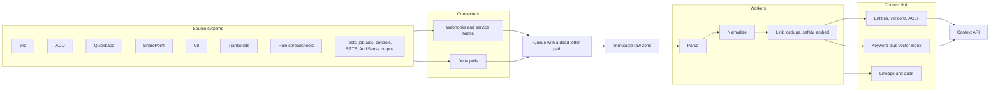

# A. Architecture

The supplied sketch draws arrows from source systems into AndiSense, and a separate box of documents into the Context Hub. That picture hides the hard part. The sources disagree, go offline, delete records, and carry their own permissions. An agent that reads them directly will mix a draft with a policy and will not be able to say which one it used.

This design puts one ingestion path in front of every source. The Context Hub stores the result. AndiSense, Journey, compliance tracking, and any later agent are consumers. AndiSense is also a source, because the sketch shows an existing AndiSense corpus (box 5.23) as well as the product (box 5.8).

## What changed from the sketch

| Sketch | This design |
| --- | --- |
| Sources point at AndiSense | Sources point at connectors. AndiSense calls the Context API. |
| Meeting transcripts appear twice, AndiSense appears twice | One connector per source. AndiSense the product is not the corpus. |
| No landing zone, cursor, or delete path | Raw zone, watermark, tombstone, reconciliation. |
| Documents sit beside the hub with no relationships | Explicit links, mentions, and an authority rule when values disagree. |
| Audit is a floating box | Every stage writes a lineage event. |
| Journey and compliance tracking are sticky notes | They stay in AndiSense until an owner is named. They read the hub; they do not copy it. |

## How a record moves

1. A connector hears a webhook or polls with the stored watermark.
2. The payload is written to the raw zone before it is interpreted. The raw copy is how we replay a failure without calling the source again.
3. A parser produces chunks. A Word section, a spreadsheet row, a function, and a transcript cue are different locators on the same entity shape.
4. The worker computes a content hash. If the hash and the access list match what is already stored, it stops. That is what keeps a catch-up poll from rewriting the corpus.
5. Hidden instructions are quarantined. Personal data is flagged and left in place for people who are allowed to see the source. Neither case is silently dropped from the raw zone.
6. Links are resolved after the batch, so a story that arrives before its requirement still gets an edge.
7. The watermark moves only after the batch has settled. A dead-lettered poison payload counts as settled. A source that is down does not move the watermark.

## What an agent is allowed to ask for

The Context API returns chunks, not an answer. Each chunk carries the source URI, version, locator, freshness, authority rank, conflicts, and flags. Records the caller cannot see are omitted. The demo console is the operator view and is not trimmed; the API is.

## Demo mapping

The runnable demo is this same pipeline on a laptop.

| Azure service in the proposal | What the demo runs |
| --- | --- |
| Azure Database for PostgreSQL with pgvector | Postgres 16 in Docker |
| ADLS Gen2 | Files under `data/raw`, mirrored to Azurite when it is up |
| Service Bus plus dead-letter queue | A Postgres queue with lock, complete, abandon, and dead-letter |
| Azure AI Search | Keyword and vector search in Postgres |
| Document Intelligence, tree-sitter, OpenAI embeddings | Heading splits, the Python AST, and a deterministic local embedding |

The production choice and the stand-in are named so the demo is not mistaken for the deployment.
