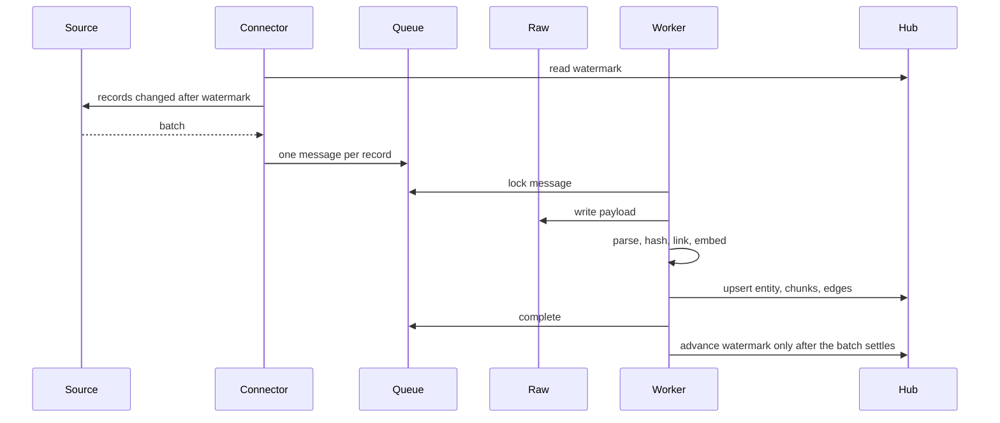
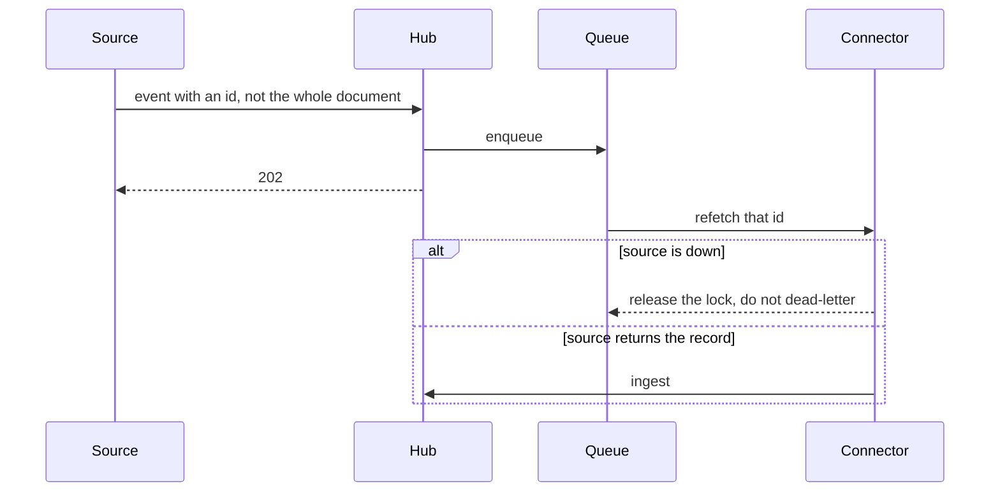
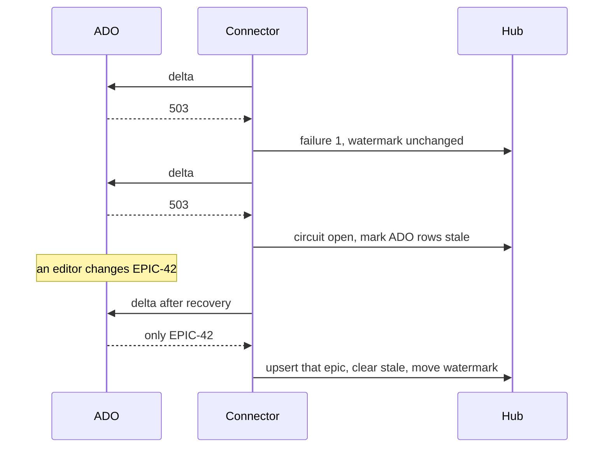
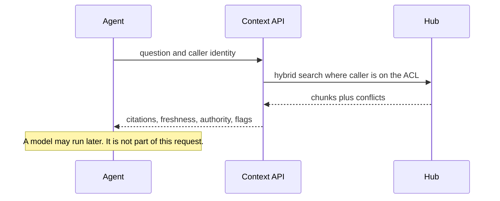

# C. Data flow

## Poll, the safety net

Webhooks are fast and they get lost. Every source also has a cursor.

Quickbase has no dependable webhook, so the poll is the only path, with backoff when the API returns 429. SharePoint uses Graph delta. Git uses the files touched since the last indexed commit. Jira uses `updated`, and a nightly id list catches deletes the webhook missed.

## Webhook

A delete event does not need a body. The worker writes a tombstone, deactivates chunks, and leaves `entity_version` in place.

## Source outage

Two failures open the circuit in this demo. Production should use a higher threshold and a half-open probe so a single blip does not stamp the corpus stale. The rule that matters is the watermark: it does not move while the fetch is failing.

## What the Context API does with a question

There is no generation step in this service. If the caller is Sam, a control document whose principals are only Alex and Compliance is absent from the payload, including its title.

## Duplicate and conflict

Identical normalized text becomes a `DUPLICATE_OF` edge from the lower-authority copy to the canonical one. The copy is not deleted. A later drift in the copy (Quickbase says 5000, the spreadsheet says 10000) opens a conflict. The winner is the source with the better rank for that field. Both values are returned to the agent.

Ranks live in `authority_rule`. Process Knowledge Governance owns changes to that table. The pipeline does not hard-code "SharePoint always wins" except as seed data for the demo.
